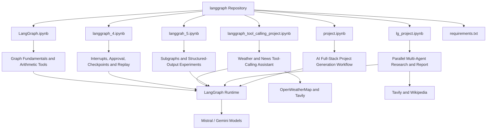
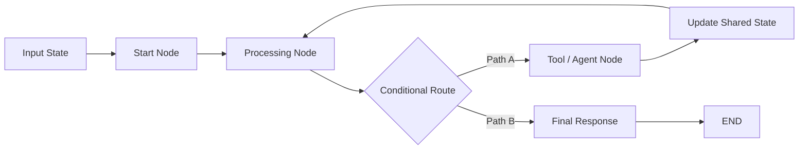
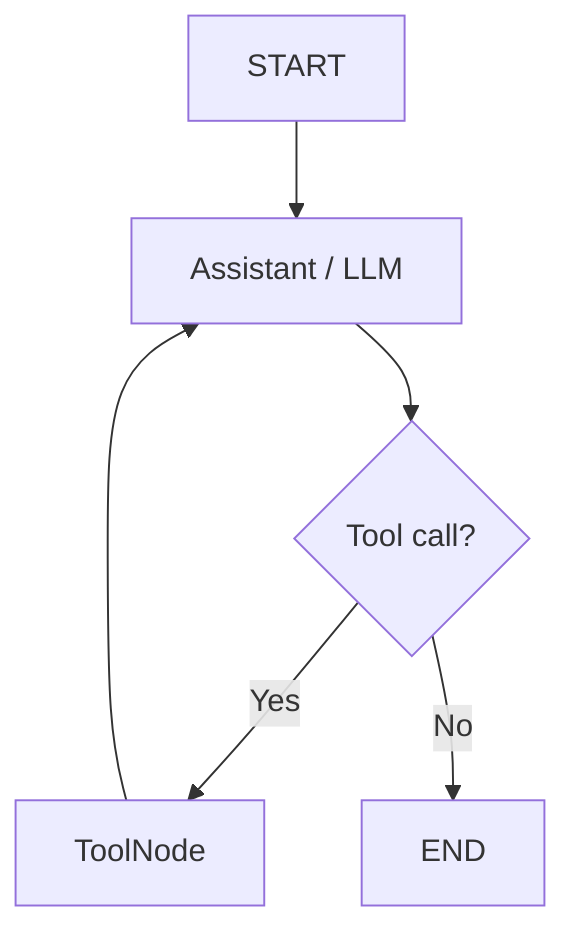
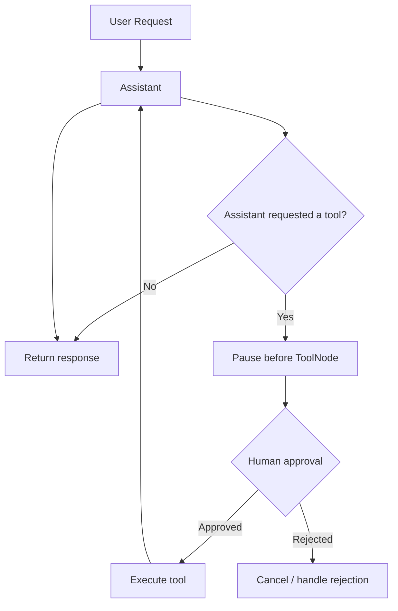
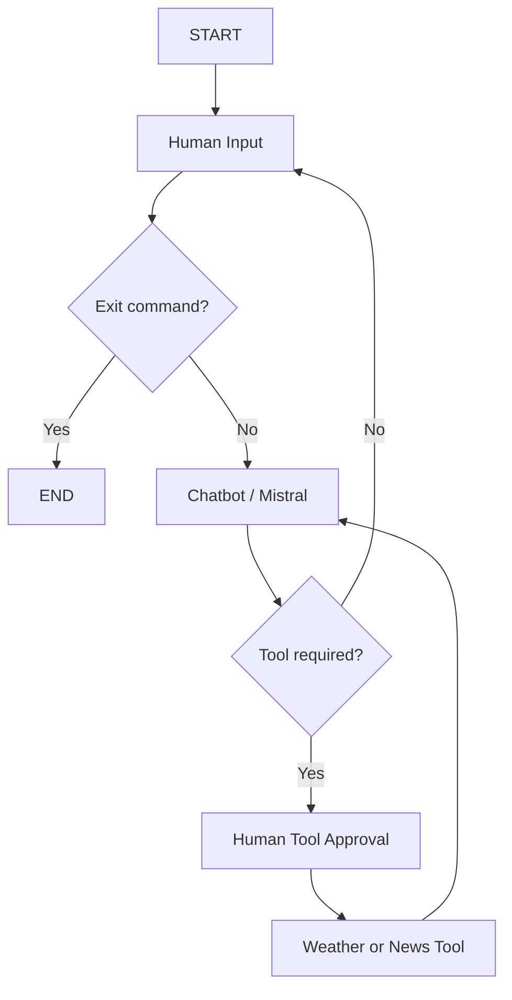
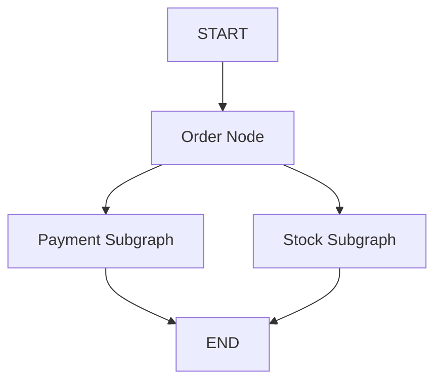
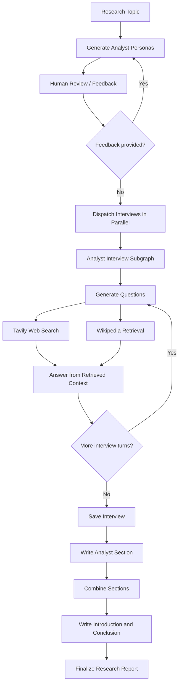
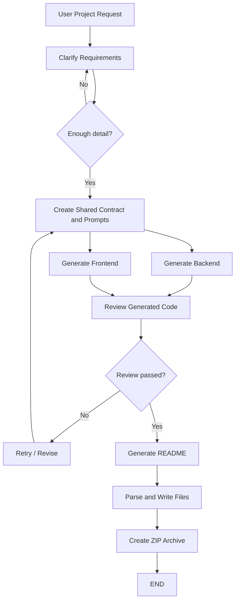
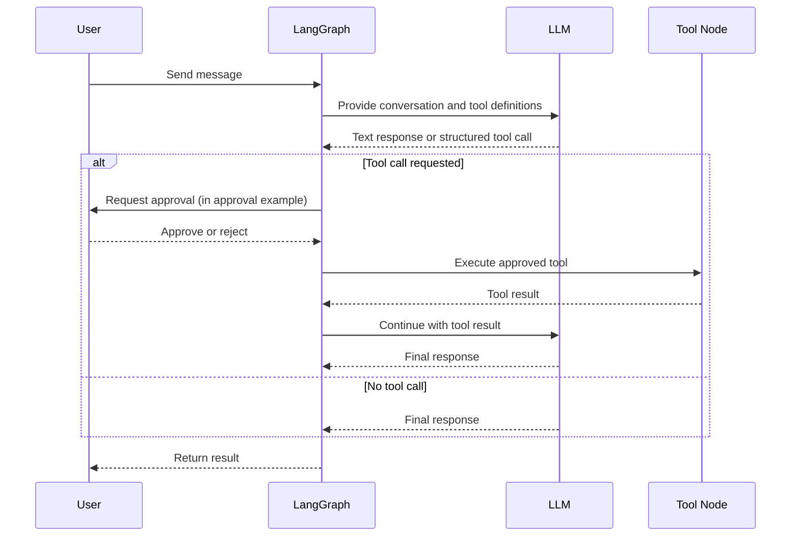

# LangGraph Learning & AI Agent Experiments

A collection of hands-on **LangGraph and LangChain notebooks** exploring stateful graph workflows, conditional routing, LLM tool calling, human-in-the-loop approvals, checkpointing, subgraphs, parallel agents, research automation, and AI-assisted full-stack project generation.

This repository is a learning and experimentation workspace. It contains notebook implementations and examples rather than a single install-and-run application.

---

## Table of Contents

- [Overview](#overview)
- [What You Can Learn](#what-you-can-learn)
- [Repository Architecture](#repository-architecture)
- [Notebook Guide](#notebook-guide)
- [Core LangGraph Concepts Demonstrated](#core-langgraph-concepts-demonstrated)
- [Project Workflows](#project-workflows)
- [Technology Stack](#technology-stack)
- [Installation](#installation)
- [API Keys and Environment Setup](#api-keys-and-environment-setup)
- [Running the Notebooks](#running-the-notebooks)
- [Important Implementation Notes](#important-implementation-notes)
- [Limitations and Future Improvements](#limitations-and-future-improvements)
- [Learning Outcomes](#learning-outcomes)
- [Author](#author)

---

## Overview

LangGraph is used in this repository to build workflows from nodes, shared state, and directed edges. Some notebooks introduce these concepts with small examples; others combine LLMs, external tools, memory, and multiple agent roles into larger workflows.

The experiments cover six main areas:

1. **Graph fundamentals:** typed state, nodes, edges, conditional routing, graph compilation, and graph visualization.
2. **LLM tool calling:** binding Python functions to a chat model and routing tool calls through LangGraph.
3. **Human-in-the-loop execution:** pausing before a tool or node, collecting a human decision, updating graph state, and resuming execution.
4. **State and memory:** message reducers, thread IDs, in-memory checkpoints, state history, and replay.
5. **Multi-agent research:** creating analyst personas, running parallel interviews, retrieving information from web and Wikipedia sources, and combining findings into a report.
6. **AI project generation:** clarifying a user request, preparing backend/frontend prompts, generating code, reviewing it, writing a README, and packaging generated files.

The notebooks primarily use Mistral models through LangChain integrations. The website-generation experiment also uses Google's Gemini integration.

## What You Can Learn

| Topic | Practical example in this repository |
|---|---|
| State management | Typed dictionaries and message-based state |
| Graph construction | `StateGraph`, `START`, `END`, nodes, and edges |
| Conditional routing | Select graph paths using a routing function |
| Message handling | `HumanMessage`, `AIMessage`, `ToolMessage`, and `add_messages` |
| Tool calling | Arithmetic functions, weather lookup, and news search |
| Agent loops | Model → tool → model cycles |
| Human approval | Interrupt execution before a tool call and request approval |
| Checkpointing | Save and resume graph state with `MemorySaver` |
| State inspection | Read current state, inspect history, update state, and replay |
| Subgraphs | Compose payment and stock sub-workflows into a parent order flow |
| Parallel execution | Use `Send` to create independent analyst interview tasks |
| Structured output | Use Pydantic models for structured LLM responses |
| Retrieval | Search the web with Tavily and retrieve Wikipedia documents |
| Workflow orchestration | Build a multi-stage research or project-generation pipeline |

## Repository Architecture

The repository is organized as a set of independent notebooks. Each notebook can be explored separately; there is no shared application entry point or common runtime package.



### Common graph execution pattern

Most examples follow the same basic LangGraph structure:



A graph node reads the current state and returns updates. Edges determine which node runs next. Conditional edges choose a route based on state or the latest message. A compiled graph can then be invoked or streamed.

## Notebook Guide

### 1. `LangGraph.ipynb` — Fundamentals and tool calling

<sub>Beginner-friendly graph construction and arithmetic assistant examples.</sub>

This notebook introduces LangGraph with a small stateful graph and gradually adds LLM capabilities.

**Topics covered:**

- Define graph state using `TypedDict`.
- Create nodes that update shared state.
- Connect `START`, normal nodes, and `END`.
- Add conditional edges to choose between alternative nodes.
- Compile a graph and visualize it as a Mermaid diagram.
- Connect a Mistral chat model through `ChatMistralAI`.
- Bind Python functions as model tools.
- Use message state and the `add_messages` reducer.
- Route tool calls with `ToolNode` and `tools_condition`.
- Build a ReAct-style assistant that can call arithmetic tools.
- Add an in-memory checkpointer to a graph.

The first example routes a state through a node that appends text and then randomly selects a happy or sad branch. Later examples introduce a multiplication tool and an arithmetic assistant with addition, subtraction, multiplication, and division.

**Conceptual flow:**



**Open in Google Colab:** [LangGraph.ipynb](https://colab.research.google.com/github/DeepanshuSharma1607/langgraph/blob/main/LangGraph.ipynb)

### 2. `langgraph_4.ipynb` — Interrupts and human-in-the-loop workflows

This notebook extends tool calling with execution control and human involvement.

**Topics covered:**

- Arithmetic tool definitions and model tool binding.
- Interrupting execution before a tool node.
- Inspecting the graph's next scheduled node with `get_state()`.
- Resuming execution after approval.
- Updating state as though a human-feedback node had executed.
- Using `MemorySaver` for thread-specific checkpoints.
- Raising an interrupt from a node based on input validation.
- Inspecting checkpoint history with `get_state_history()`.
- Replaying from an earlier state snapshot.

One example pauses before an arithmetic tool is run. The user can approve the operation and resume the graph, or cancel it. Another example interrupts when an input string is longer than a configured limit, lets the caller update the state, and continues execution.

**Human approval flow:**



**Open in Google Colab:** [langgraph_4.ipynb](https://colab.research.google.com/github/DeepanshuSharma1607/langgraph/blob/main/langgraph_4.ipynb)

> The notebook's stored output includes a deprecation warning for `NodeInterrupt`. Review the current LangGraph interrupt API before using that particular example in a new application.

### 3. `langgraph_tool_calling_project.ipynb` — Weather and news assistant

A terminal-style conversational agent that can answer ordinary messages and request external tools when live information is needed.

**Tools implemented:**

| Tool | Purpose | External service |
|---|---|---|
| `get_weather(city)` | Retrieves current weather description and temperature | OpenWeatherMap |
| `get_news(city)` | Searches for recent news related to a city | Tavily |

**Workflow behaviour:**

1. A human node collects a message from the terminal.
2. A routing function checks for exit commands such as `exit`, `quit`, or `bye`.
3. The Mistral-powered chatbot decides whether a tool is needed.
4. If a tool call is requested, a dedicated node asks the user for approval.
5. Approved tool calls are executed and their results are passed back to the chatbot.
6. The chatbot formats the response and the conversation returns to the human input node.

**Architecture:**



The notebook uses `MemorySaver` and a thread ID when compiling and invoking the conversation graph.

**Open in Google Colab:** [langgraph_tool_calling_project.ipynb](https://colab.research.google.com/github/DeepanshuSharma1607/langgraph/blob/main/langgraph_tool_calling_project.ipynb)

### 4. `langgrah_5.ipynb` — Subgraphs and structured-output experiments

This notebook explores composing smaller graphs into a larger workflow.

**Order workflow:**

- A payment subgraph returns a simulated payment status.
- A stock subgraph returns a simulated stock/order status.
- A parent graph runs an order node and branches into the payment and stock subgraphs.
- A `MemorySaver` checkpointer is attached to the graph.
- A thread ID is used when invoking the parent graph.

The payment and stock functions return fixed demonstration values; they do not connect to a real payment gateway, inventory system, or order database.

The notebook then begins a second experiment around structured generation. It defines Pydantic models for a list of related subtopics and for choosing a best joke, along with prompts for generating subtopics and jokes. The tracked notebook ends during this setup, before a complete end-to-end joke-generation graph is constructed.

**Subgraph concept:**



**Open in Google Colab:** [langgrah_5.ipynb](https://colab.research.google.com/github/DeepanshuSharma1607/langgraph/blob/main/langgrah_5.ipynb)

### 5. `lg_project.ipynb` — Multi-agent research and report generation

This is the repository's research-oriented multi-agent workflow.

The objective is to take a topic, create specialized analyst personas, gather information through interviews and retrieval, and produce a consolidated report.

**Main stages:**

1. **Analyst creation:** a Mistral model uses structured output and Pydantic schemas to generate analyst personas with names, affiliations, roles, and research interests.
2. **Human review:** execution pauses at a feedback node so the analyst list can be reviewed or revised.
3. **Parallel interviews:** LangGraph's `Send` API dispatches separate interview tasks to a reusable interview subgraph.
4. **Question generation:** each analyst asks focused questions based on its persona.
5. **Information retrieval:** the workflow generates a search query and retrieves source material using Tavily and Wikipedia.
6. **Answer generation:** the model answers using retrieved context and is instructed to preserve source references.
7. **Section writing:** each analyst's interview and research context are transformed into a report section.
8. **Report synthesis:** sections are consolidated into a single report, with introduction and conclusion sections.
9. **Finalization:** the final state contains the assembled report.

**Research workflow:**



**Key LangGraph features used:**

- Nested graphs / subgraphs.
- Parallel fan-out using `Send`.
- Typed state and Pydantic structured outputs.
- Human-in-the-loop feedback using an interrupt and state updates.
- `MemorySaver` for checkpointing.
- Retrieval from web search and Wikipedia.
- Multi-stage report composition.

**External integrations:**

- Mistral via `ChatMistralAI`
- Tavily via `langchain_tavily.TavilySearch`
- Wikipedia via `WikipediaLoader` from `langchain_community`

**Open in Google Colab:** [lg_project.ipynb](https://colab.research.google.com/github/DeepanshuSharma1607/langgraph/blob/main/lg_project.ipynb)

### 6. `project.ipynb` — AI-powered full-stack project generation

This notebook prototypes an agentic workflow for turning a high-level website request into generated backend and frontend code.

It combines Google Gemini and Mistral integrations with a LangGraph workflow.

**Intended stages:**

1. **Requirements clarification:** gather a project description and ask follow-up questions for missing requirements, with a maximum of three clarification rounds in the notebook logic.
2. **Prompt architecture:** derive a shared contract covering project structure, API routes, request/response formats, authentication, environment variables, and CORS.
3. **Backend generation:** use an LLM node to generate backend project code.
4. **Frontend generation:** use a separate LLM node to generate frontend project code.
5. **Review/testing:** submit the generated code to an LLM-based reviewer for checks such as missing files, imports, endpoint mismatches, and runtime risks.
6. **Retry control:** attempt to route back through generation when the reviewer reports issues.
7. **README generation:** ask an LLM to document the generated project.
8. **Code assembly:** parse generated code blocks, create backend and frontend directories, and write the generated files.
9. **ZIP packaging:** create a ZIP archive of the generated project.

**Intended workflow:**



**Technologies visible in the notebook:**

- LangGraph and LangChain.
- Google Gemini through `ChatGoogleGenerativeAI`.
- Mistral through `ChatMistralAI`.
- Pydantic and typed state.
- `MemorySaver` and `InMemoryStore`.
- Python `pathlib`, `re`, and `shutil` for generated file handling.

**Important:** this notebook is a prototype, not a verified autonomous website builder. Several parts require further implementation and validation; see [Important Implementation Notes](#important-implementation-notes).

**Open in Google Colab:** [project.ipynb](https://colab.research.google.com/github/DeepanshuSharma1607/langgraph/blob/main/project.ipynb)

---

## Core LangGraph Concepts Demonstrated

### 1. StateGraph

A `StateGraph` is created with a state schema, usually a `TypedDict` or a message-state type. Nodes receive state and return updates to it.

```python
from typing import TypedDict
from langgraph.graph import StateGraph, START, END

class State(TypedDict):
    message: str

def greet(state: State):
    return {"message": state["message"] + " Hello!"}

builder = StateGraph(State)
builder.add_node("greet", greet)
builder.add_edge(START, "greet")
builder.add_edge("greet", END)

graph = builder.compile()
result = graph.invoke({"message": "Hi"})
print(result)
```

### 2. Conditional edges

A routing function can inspect the current state and return the name of the next node. The first notebook uses conditional routing for a simple mood example; the tool-calling notebooks use `tools_condition` to route based on whether the model requested a tool.

### 3. Message reducers

The `add_messages` reducer is used to append and manage conversation messages in graph state. This helps maintain a conversation history across assistant and tool nodes.

### 4. ToolNode and tools_condition

The prebuilt `ToolNode` executes tool calls from AI messages. `tools_condition` checks whether the most recent assistant message contains a tool call and routes the graph accordingly.

### 5. Checkpointing and threads

The notebooks use:

```python
from langgraph.checkpoint.memory import MemorySaver

memory = MemorySaver()
graph = builder.compile(checkpointer=memory)

config = {
    "configurable": {
        "thread_id": "user-session-1"
    }
}
```

The thread ID identifies a graph execution thread for checkpoint/state operations. `MemorySaver` is an in-memory checkpointer: it is useful for demonstrations and short-running processes, but it is not durable storage across process restarts.

### 6. Human-in-the-loop execution

Some notebooks compile graphs with an interrupt point, inspect the checkpointed state, gather user approval or feedback, update the state, and resume execution. This makes it possible to review tool actions or generated content before the graph continues.

### 7. Subgraphs and parallel agents

A compiled graph can be used as a node in a parent graph. The research workflow also uses `Send` to create multiple independent analyst tasks from a shared topic.

## Project Workflows

### Tool-calling assistant lifecycle

The arithmetic, weather, and news examples demonstrate how an LLM can choose a tool and how LangGraph can safely route the request to a corresponding execution node.



### Multi-agent research lifecycle

The research notebook separates responsibilities across analyst creation, interview execution, retrieval, writing, and report synthesis. Parallel interview tasks can work on different research angles before their outputs are combined.

## Technology Stack

| Technology / Library | Usage |
|---|---|
| Python | Main programming language |
| LangGraph | Stateful graph orchestration, routing, subgraphs, interrupts, and checkpoints |
| LangChain | LLM abstractions, chat messages, tools, and integrations |
| Mistral AI | Chat model used in arithmetic, tool-calling, and research experiments |
| Google Gemini | Model integration used in the project-generation notebook |
| Pydantic | Typed and structured model outputs |
| Tavily | Web search and research retrieval |
| OpenWeatherMap API | Current weather lookup in the weather/news assistant |
| Wikipedia / WikipediaLoader | Knowledge retrieval in the research workflow |
| Requests | HTTP requests |
| Rich | Readable console output |
| IPython / Jupyter | Notebook execution and graph visualization |
| LangSmith | Listed as a dependency for tracing/observability integration; not configured as a complete tracing setup in these notebooks |

## Installation

### Prerequisites

- Python 3.10+ recommended for a modern LangGraph/LangChain environment.
- Git.
- Jupyter Notebook or JupyterLab, or a Google Colab account.
- API credentials for the external model/search/weather services used by the notebook you want to run.

The notebooks were developed as experiments and do not pin a single tested set of dependency versions. Some examples use different integration packages and API patterns.

### 1. Clone the repository

```bash
git clone https://github.com/DeepanshuSharma1607/langgraph.git
cd langgraph
```

### 2. Create a virtual environment

**Windows PowerShell:**

```powershell
python -m venv .venv
.venv\Scripts\Activate.ps1
```

**Linux / macOS:**

```bash
python3 -m venv .venv
source .venv/bin/activate
```

### 3. Install the repository's listed dependencies

```bash
python -m pip install --upgrade pip
pip install -r requirements.txt
```

The current `requirements.txt` lists:

- `langgraph`
- `langchain`
- `pydantic`
- `langsmith`

### 4. Install notebook-specific integrations

The base requirements file does not include every integration imported by the notebooks. Install the extras required for the notebooks you plan to run:

**Mistral chat model integration:**

```bash
pip install langchain-mistralai
```

**Gemini chat model integration:**

```bash
pip install langchain-google-genai
```

**Tavily search integration:**

```bash
pip install langchain-tavily tavily-python
```

**Wikipedia retrieval:**

```bash
pip install langchain-community wikipedia
```

**Other notebook utilities:**

```bash
pip install requests rich ipython jupyter
```

Install only the integrations needed for the notebook you are running. Because dependencies are not pinned, resolving incompatible versions may require adjusting package versions together.

### 5. Start Jupyter

```bash
jupyter lab
```

Or:

```bash
jupyter notebook
```

Open a notebook from the repository root and execute its cells in order.

## API Keys and Environment Setup

Several notebooks need external credentials. Never commit API keys, tokens, or other secrets to GitHub.

| Environment variable / notebook variable | Used for |
|---|---|
| `CHAT_MISTRAL_API_KEY` | Mistral model access |
| `GOOGLE_API_KEY` | Gemini model access |
| `TAVILY_API_KEY` | Tavily search |
| `OPENAPI_WEATHER_API_KEY` | OpenWeatherMap weather lookup |

The notebook code currently assigns credentials directly in cells (often as empty strings or placeholder text). It does not consistently load a `.env` file. Set the values locally and update the relevant notebook cells to read them from environment variables.

**Windows PowerShell:**

```powershell
$env:CHAT_MISTRAL_API_KEY="your_mistral_key"
$env:GOOGLE_API_KEY="your_google_key"
$env:TAVILY_API_KEY="your_tavily_key"
$env:OPENAPI_WEATHER_API_KEY="your_openweathermap_key"
```

**Linux / macOS:**

```bash
export CHAT_MISTRAL_API_KEY="your_mistral_key"
export GOOGLE_API_KEY="your_google_key"
export TAVILY_API_KEY="your_tavily_key"
export OPENAPI_WEATHER_API_KEY="your_openweathermap_key"
```

Example pattern for a notebook cell:

```python
import os

CHAT_MISTRAL_API_KEY = os.environ["CHAT_MISTRAL_API_KEY"]
GOOGLE_API_KEY = os.environ.get("GOOGLE_API_KEY")
TAVILY_API_KEY = os.environ.get("TAVILY_API_KEY")
OPENAPI_WEATHER_API_KEY = os.environ.get("OPENAPI_WEATHER_API_KEY")
```

Pass the key variable to the corresponding integration when creating the model or client. For Gemini, the notebook configures the Google integration through `GOOGLE_API_KEY`.

If a key is missing, the relevant external call will fail. You do not need provider keys for the self-contained graph/state examples that do not invoke an external model or service.

## Running the Notebooks

A suggested learning order:

1. `LangGraph.ipynb` — understand nodes, state, edges, and tool calling.
2. `langgraph_4.ipynb` — understand interrupts, approval, checkpointing, and replay.
3. `langgraph_tool_calling_project.ipynb` — see tool routing in a conversational workflow.
4. `langgrah_5.ipynb` — understand composing subgraphs and structured-output setup.
5. `lg_project.ipynb` — explore parallel research agents and report generation.
6. `project.ipynb` — study a larger multi-stage code-generation workflow.

### Run in Google Colab

Each notebook includes an **Open in Colab** badge at the top. The repository also provides direct Colab links in the notebook guide above.

When using Colab:

1. Open the notebook using its Colab link.
2. Install that notebook's missing integration packages in a setup cell.
3. Add API keys through Colab's secret manager or environment variables.
4. Run cells in sequence.
5. Review generated graph diagrams and intermediate state before proceeding.

Do not paste API keys into notebook cells that will be committed to a public repository.

## Important Implementation Notes

These points are based on the tracked notebook code and should be considered before using the experiments as the foundation for another application.

### 1. This is a notebook collection, not a production package

There is no shared `src/` package, CLI entry point, server, frontend, Docker configuration, or automated test suite in the repository tree. Run individual notebooks in their own environment.

### 2. Dependencies are incomplete and unpinned

The root `requirements.txt` contains only four top-level packages. It does not list all notebook integrations, including Mistral, Gemini, Tavily, Wikipedia, Requests, Rich, and Jupyter-related packages. It also does not lock versions.

### 3. API credentials must be configured locally

The notebooks contain empty assignments or placeholder strings for API keys. One early model example also contains a literal placeholder value. Replace all placeholders with environment-based configuration and keep secrets out of source control.

### 4. External integrations require network access and service credentials

Weather, web search, and hosted LLM examples depend on external services. Their results, availability, cost, rate limits, and model support depend on the provider.

### 5. In-memory checkpoints are not durable storage

`MemorySaver` and `InMemoryStore` are used for learning and short-lived execution. They do not provide a configured persistent database-backed production memory layer.

### 6. The research workflow needs additional validation

The research notebook is an experimental multi-agent workflow. Validate search results, citations, source quality, parallel state aggregation, and report completeness before relying on generated reports.

### 7. The project-generation workflow is a prototype

In `project.ipynb`, the human-query node is a placeholder, the integration node currently returns an empty update, and the LLM-based generation and review steps need end-to-end verification. The code-generation parser relies on a particular fenced-code output format. Generated files should be inspected and tested before execution. The notebook's retry and routing logic should also be validated with multiple failure and success cases.

### 8. The structured joke example is unfinished

`langgrah_5.ipynb` defines prompts and Pydantic output schemas for subtopic and joke generation, but the tracked notebook ends before the full graph is assembled.

### 9. Interrupt API compatibility should be reviewed

The interrupt examples were created against particular LangGraph APIs. One saved notebook output reports a deprecation warning for `NodeInterrupt`; update that experiment to the supported interrupt API before reusing it in a current project.

## Limitations and Future Improvements

- Add a pinned, notebook-aware dependency specification or separate requirements files for each experiment.
- Replace inline API key assignments with secure environment-variable handling.
- Add a shared utility module for model initialization, API clients, and environment validation.
- Add runnable Python scripts alongside notebooks for the most useful workflows.
- Add automated tests for state transitions, routing functions, tool execution, and error handling.
- Add persistent checkpointing for workflows that need to survive process restarts.
- Add robust retry policies, timeouts, rate-limit handling, and structured error states for API calls.
- Add safeguards and explicit human approval for sensitive or irreversible tool actions.
- Validate web sources and make report citations traceable to retrieved documents.
- Complete the structured joke-generation graph in `langgrah_5.ipynb`.
- Implement and test the missing integration and retry logic in `project.ipynb`.
- Add an end-to-end example showing how to deploy a LangGraph workflow behind an API.
- Document expected model versions and provider requirements for each notebook.

## Learning Outcomes

By exploring this repository, a developer can build familiarity with:

- Designing stateful LLM workflows instead of relying only on linear prompt chains.
- Separating agent responsibilities into graph nodes.
- Routing model decisions to deterministic Python tools.
- Pausing execution for human review and resuming from checkpoints.
- Maintaining conversation state across turns.
- Composing subgraphs and dispatching parallel tasks.
- Combining structured model output with retrieval and report-writing workflows.
- Orchestrating a multi-stage AI software-generation experiment.

## Author

**Deepanshu Sharma**

- GitHub: [@DeepanshuSharma1607](https://github.com/DeepanshuSharma1607)
- Repository: [langgraph](https://github.com/DeepanshuSharma1607/langgraph)

---

*This README documents the notebooks and dependencies present in the repository's `main` branch when it was prepared. It distinguishes demonstrated notebook experiments from unfinished or unverified workflow components.*
